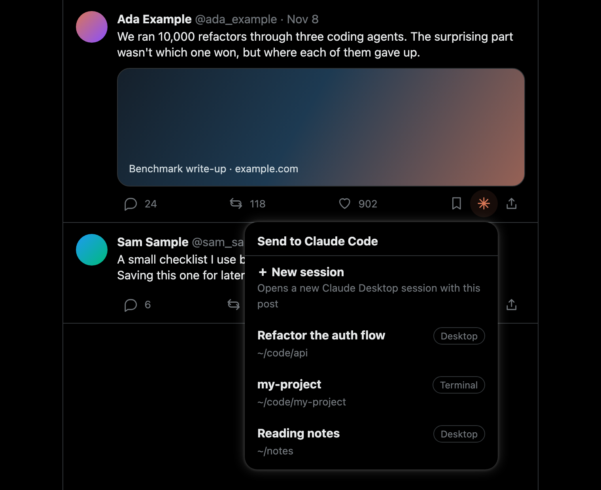

# x-to-claude

Send a post from X to a Claude Code session on your Mac with one click.

x-to-claude adds a button to every post on x.com. It can send the post to any Claude Code session you have open, start a new session to discuss it, or file it in a searchable archive that Claude keeps organized for you.



<sub>The extension's session menu. The posts and session names shown are sample data.</sub>

```
Browser extension (x.com)  ──HTTP, token──▶  local relay (127.0.0.1:47615)  ──Unix socket──▶  Claude Code session
                                                   ▲
                               ~/.x-to-claude/sessions/*.json  ◀── SessionStart / SessionEnd hooks
```

> **Unofficial.** This project isn't affiliated with or endorsed by X or Anthropic. It relies on undocumented Claude Code internals that can change in any release; see [Limitations](#limitations).

## What it does

| Action | Result |
|---|---|
| **Right-click** the button (or Shift+Enter) | Lists your live Claude Code sessions, from both the terminal and the desktop app. The post goes to the one you pick, with its URL, author, date, text, any quoted post and media links. |
| **Right-click → ＋ New session** | Opens a new Claude Desktop session about the post. Claude summarizes it and asks what you'd like to do with it. |
| **Left-click** the button | Saves the post to your [archive](#the-archive), where it's classified and written up as a Markdown note. Saved posts show an orange button. |

Post text is untrusted, so every message tells Claude to treat it as data rather than instructions. See [Security](#security).

## Requirements

- macOS. The relay uses launchd and `open`, and the session sockets were only tested on macOS.
- Node 20 or later. There are no npm dependencies.
- A Chromium-based browser (Chrome 116+, Arc).
- [Claude Code](https://code.claude.com/docs). The ＋ New session action also needs Claude Desktop.

## Setup

1. Clone the repository:
   ```bash
   git clone https://github.com/toprakkara/x-to-claude.git
   ```
   ```bash
   cd x-to-claude
   ```
   Then write the relay's token into the extension folder. This creates `~/.x-to-claude/config.json` and `extension/relay.json` (mode 0600, git-ignored):
   ```bash
   npm run extension:config
   ```
2. Add the session hooks to your user settings (`~/.claude/settings.json`; a backup is made first). To preview the change, add `--dry-run`:
   ```bash
   node scripts/install-hooks.mjs --dry-run
   ```
   ```bash
   npm run hooks:install
   ```
   Only sessions started or resumed **after** this step appear in the list.
3. Install the launchd agent, so the relay starts at login and restarts if it crashes. To try it out first, `npm run relay` runs it in the foreground instead.
   ```bash
   npm run launchd:install
   ```
4. Load the extension: open `chrome://extensions` (`arc://extensions` in Arc), turn on Developer mode, click **Load unpacked** and pick the `extension/` folder. To check the connection, click the extension's icon and press **Test connection**.
5. Optional: copy the extension ID shown on that page into the `extensionId` field of `~/.x-to-claude/config.json`, then run `npm run launchd:restart`. The relay then accepts requests only from this extension. An unpacked extension's ID comes from its folder path, so moving the folder changes it.
6. Optional: set up the archive, which the left-click save needs. Then start the archivist once from the archive folder and accept the trust dialog; you can exit right after. **Don't skip this:** until a folder is trusted, Claude Code ignores its `.claude/settings.json`, so background runs can't write any notes.
   ```bash
   npm run archive:init
   ```
   ```bash
   cd ~/x-archive && claude --name x-archive --permission-mode dontAsk --strict-mcp-config
   ```

To manage the agent, use `npm run launchd:status`, `npm run launchd:restart` (after a code or `config.json` change) and `npm run launchd:uninstall`. The agent uses the absolute path of the Node binary that was active at install time, so run the install again if you switch Node versions.

## The archive

The archive is a folder (`archiveDir`, default `~/x-archive`) with its own Claude Code session, the **archivist**. `npm run archive:init` creates it:

| Path | Contents |
|---|---|
| `CLAUDE.md` | The archivist's instructions |
| `.claude/settings.json` | The archivist's permissions |
| `categories.md` | The categories, one `- slug — description` line each. Edit these to suit you. |
| `inbox/` | Incoming posts: `queue.jsonl` from the button, plus imports and hand-off lists |
| `plan/` | One classification line per post |
| `library/<category>/<date>-<handle>-<id>.md` | The notes, plus `_index.md` |
| `log.md` | One line per job |
| `notifications.jsonl` | The topic notices the relay sent |

Notes are never written by hand. A plan line goes through `scripts/render-archive.mjs`, which writes or moves the note. The archivist runs in `dontAsk` mode with a narrow allow-list: it can edit only `categories.md`, `log.md` and `plan/`, run only the note writer, and list and message sessions. It has no other shell access and no web access.

You don't need to keep the archivist open. When a save needs it and none is running, the relay runs `claude -p` in the archive folder, with the same permissions and no MCP servers, and passes it the IDs still waiting in `inbox/queue.jsonl`. The archivist classifies them and exits.

- Rapid saves are batched into one wake-up (10 s).
- A save that arrives during a run triggers one more run afterwards, if it's still waiting.
- A failed run blocks new wake-ups for 30 minutes.
- The relay also checks the queue at start-up and every 30 minutes.
- If the archive folder isn't trusted, wake-ups stop, because a run couldn't write anything. Accept the trust dialog and run `npm run launchd:restart`. `archivist-wake.log` shows when this has happened.

You can still open the archivist yourself to talk to it. While it's open, the relay sends saves to it directly. Run this from the archive folder:

```bash
claude --name x-archive --permission-mode dontAsk --strict-mcp-config
```

The relay recognizes the archivist by its working directory, not by its name.

### Jev: optional fast classification

Each archivist run costs Claude usage. You can have [Jev](https://typesafe.ai), TypeSafe's paid decision model, handle the easy cases first. **With Jev turned on, the text of every saved post is sent to that service.**

To turn it on, put a key in `~/.x-to-claude/jev.env` and run `npm run launchd:restart`:

```
OPENROUTER_API_KEY=sk-or-...
```

`TYPESAFE_API_KEY` works too. If Jev picks an existing category with confidence ≥ `jevThreshold` (0.85), the relay writes the note itself. Otherwise the post goes to the archivist with Jev's top guesses as a hint. Without a key, every save goes to the archivist.

Jev can also tell another session about posts on a topic it cares about. Add routes to `notifyRoutes` in `config.json`, and a saved post rated at or above `threshold` sends a short notice to the live session with that name:

```json
"notifyRoutes": [{ "name": "my-research", "topic": "legal tech: AI tools for lawyers and courts", "threshold": 0.7 }]
```

Two scripts help with bulk imports, and both run from the archive folder:

- `scripts/fetch-oembed.mjs` fetches post content from X's oEmbed endpoint. It's resumable.
- `scripts/jev-batch.mjs` classifies an import with Jev and writes a hand-off list for the archivist.

## New sessions and the Claude login

**＋ New session** runs the first turn in the background with all tools off, because the post is untrusted, and then opens the session in Claude Desktop with `claude://resume?session=<id>`. The session is named `X: @handle — …`. Code sessions need a folder, so these live in an empty one of their own (`newSession.dir`, default `~/x-chats`).

New sessions and archivist wake-ups both run `claude -p`, which uses the CLI's own login. If that login expires they stop working, while Desktop sessions carry on because they manage theirs separately. The extension shows a **Sign in** button when this happens: in the session menu, after a failed new session, and after a save that can't wake the archivist. The button makes the relay run `claude auth login`, which opens the sign-in page in your browser. Once you sign in, the interrupted new session opens by itself and the archivist runs straight away.

## Configuration

Settings live in `~/.x-to-claude/config.json`. Run `npm run launchd:restart` after changing them.

| Key | Default | Meaning |
|---|---|---|
| `port` | `47615` | The relay's port |
| `extensionId` | `null` | If set, only this extension may call the relay |
| `priority` | `null` | Inbox priority: `now`, `next` or `later` |
| `archiveDir` | `~/x-archive` | The archive folder |
| `archivistName` | `x-archive` | Preferred session name if several share the archive folder |
| `archivistWake` | enabled | `enabled`, `claudePath`, `model` (`null` uses your default) |
| `newSession` | enabled | `enabled`, `dir`, `model` |
| `jevEnvFile` | `~/.x-to-claude/jev.env` | Where Jev's key is read from; it's never copied into the config |
| `jevThreshold` | `0.85` | Confidence needed for Jev to write a note itself |
| `notifyRoutes` | `[]` | Topic notices: `name`, `topic`, `threshold` |

`claudePath` is also used for new sessions and the sign-in button. It's detected once, when the config is first created, by checking the usual install locations and then your `PATH`. If the extension says Claude Code wasn't found, or you later move your install, set it by hand. `which claude` shows the right value.

Logs are in `~/.x-to-claude/`: `relay.log`, `new-session.log`, `archivist-wake.log` and `claude-login.log`.

## Delivery rules

The relay isn't a child process of the target session and sends no auth line, so Claude Code treats its messages as coming from another session that asserts no permission class:

- **Sessions that prompt for permissions** (default, auto, acceptEdits) deliver the message right away.
- **Sessions that bypass permissions** hold the message for approval. In the terminal, an approval dialog opens. The desktop app and VS Code can't show that dialog, so the message is dropped after 5 minutes.

To deliver to bypass-mode sessions too, set [`crossSessionInbound`](https://code.claude.com/docs/en/cross-session-messaging) to `"accept"`. This applies to every message from your other sessions, not only the relay's, so consider it carefully.

The relay's `ok` response only means the message was written to the socket. The socket sends no reply, so the relay isn't told when a message is held or dropped.

Each message carries a `session_id`. If the socket has since passed to another session, Claude Code drops the message, so it never reaches the wrong session.

## Security

- The relay listens only on 127.0.0.1. Every request needs `X-Relay-Token`. An `Origin` header, if present, must be `chrome-extension://`. The `Host` header must be 127.0.0.1 or localhost, which guards against DNS rebinding. The relay sends no CORS headers.
- The token lives only in the extension's service worker and never reaches the x.com page.
- Post text travels between randomly generated delimiters, with a note saying it's data, not instructions. **This lowers the risk of prompt injection but can't remove it.** A post you send to a session with broad permissions is still attacker-controlled text in that session, so send with care.
- The first turn of a new session runs with all tools off. The archivist has no web access and a narrow allow-list.
- The relay never exposes a session's socket path. The hooks don't store the session token.
- `/claude-login` only runs the fixed commands `claude auth status` and `claude auth login`. You sign in yourself in the browser, and the relay handles no credentials.

To report a vulnerability, see [SECURITY.md](SECURITY.md).

## Limitations

These can break with a new Claude Code release or a change to X:

- The inbox socket's message format isn't documented. It comes from Claude Code 2.1.286 (`relay/inbox.mjs`).
- Session titles are read from `~/.claude/sessions/<pid>.json`, an undocumented internal file. Without it the menu falls back to folder names. The relay reads only the `name` field, and never the `.key` files in that folder.
- The `claude://resume` link format comes from `claude --desktop` in Claude Code 2.1.290. The relay can't call `claude --desktop` itself, because that command needs a terminal.
- The extension reads X's page structure (`data-testid` attributes), which X can change at any time.

## Development

```bash
npm test
```

The tests never touch real Claude sessions; they open their own fake inbox sockets in a temp folder. For the extension's DOM side there is `test/fixtures/x-dom.html`, which mimics X's markup and stubs `chrome.runtime`. Serve the repository root with any static server (`python3 -m http.server`, or the `fixture` entry in `.claude/launch.json`) and open that page. Append `?mode=down|notoken|error|login` and `&theme=dark` to try the error states and the dark theme.

See [CONTRIBUTING.md](CONTRIBUTING.md).

## License

MIT. See [LICENSE](LICENSE).
