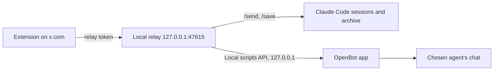

# OpenBot target (experimental)

The right-click menu can also send a post to an OpenBot agent on this Mac. The post lands in the agent's chat, and the agent summarizes it and asks what you'd like to do with it.

A **Claude Code | OpenBot** switch at the top of the menu picks which list it shows. The choice applies to every tab, and the button on each post shows the OpenBot logo while OpenBot is picked. A left click still saves to the archive either way.

It's off unless `config.json` has `"openbot": { "enabled": true }`; without it the relay and the extension behave exactly as before.



## How it works

The relay uses OpenBot's **Local scripts** API, the same one OpenBot's `openbot-cli` uses.

- While at least one agent has Local scripts on, OpenBot listens on 127.0.0.1 and writes its address and a token to its automation folder. On macOS that's `~/Library/Application Support/OpenBot/automation`. Both change when OpenBot restarts, so the relay reads them on every request.
- With OpenBot picked, the menu lists the agents that have Local scripts on (`GET /v1/agents`). Each one shows the OpenBot logo, which the relay reads from the installed OpenBot app and shrinks with macOS's `sips`; the logo isn't part of this repository. The Local scripts API has no per-agent avatars yet.
- Picking one sends the post to that agent's chat (`POST /v1/agents/<id>/messages`).

The post is validated and cleaned exactly as for Claude Code. It travels inside the same envelope: a note that it's third-party data, not instructions, with the text between random delimiters. The relay talks only to OpenBot on this Mac; after that, the agent's model provider sees the message, as with anything you send that agent.

The extension never talks to OpenBot. OpenBot refuses requests that carry an `Origin` header, so only the relay can call it.

The token can do more than send messages: OpenBot also lets it run routines and answer an agent's questions and approvals. The relay uses only the two calls above, sends the token only to a 127.0.0.1 address, and never logs or returns it.

Tested end to end with a live agent in the OpenBot desktop app of November 2026. The agent sees the message as if you had typed it, which is why the envelope matters.

## Setup

1. In OpenBot, turn on **Local scripts** for each agent you want in the menu.
2. Add this to `~/.x-to-claude/config.json`:
   ```json
   "openbot": { "enabled": true }
   ```
   If OpenBot keeps its automation folder somewhere else, add `"automationDir": "/absolute/path"`.
3. Run `npm run launchd:restart`, then reload the extension.

If OpenBot isn't running or no agent has Local scripts on, the menu's OpenBot section says so, and the Claude Code part keeps working.

OpenBot limits how many messages local scripts can send each agent per hour. Over the limit, the menu shows OpenBot's message.
